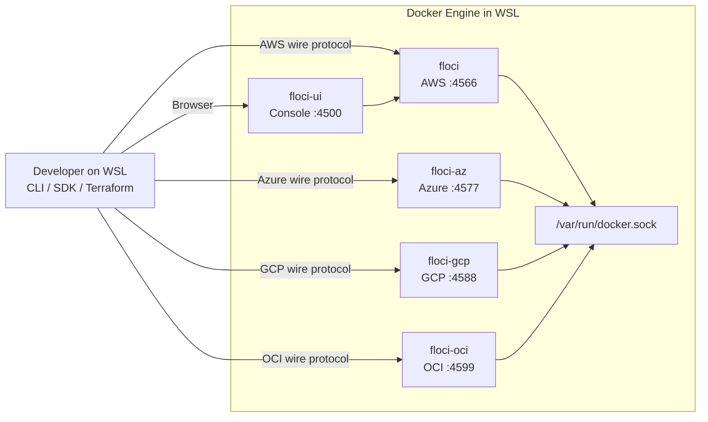
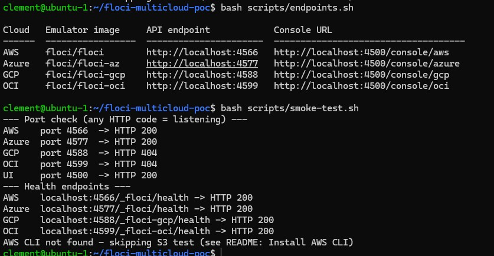
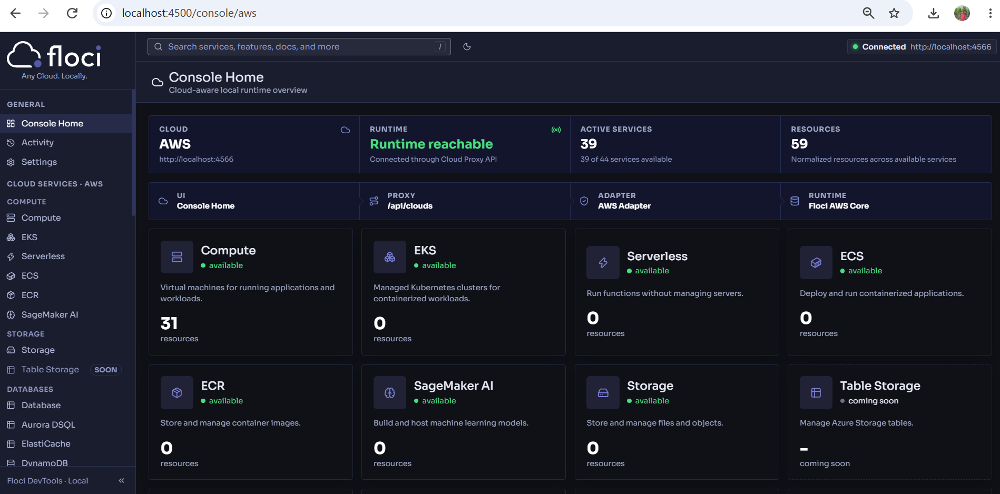
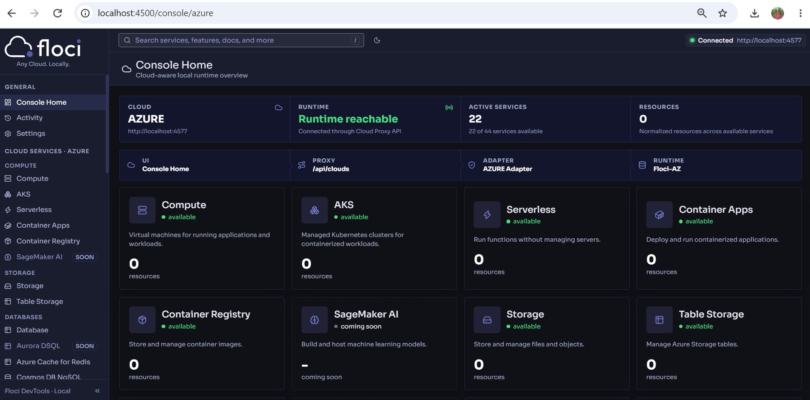
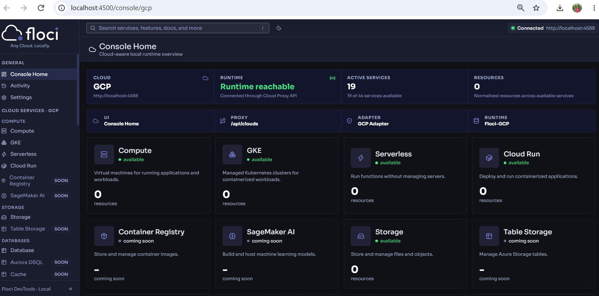
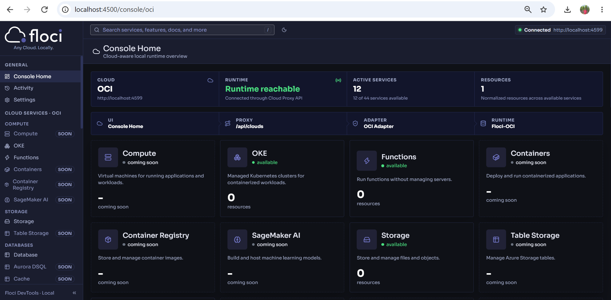
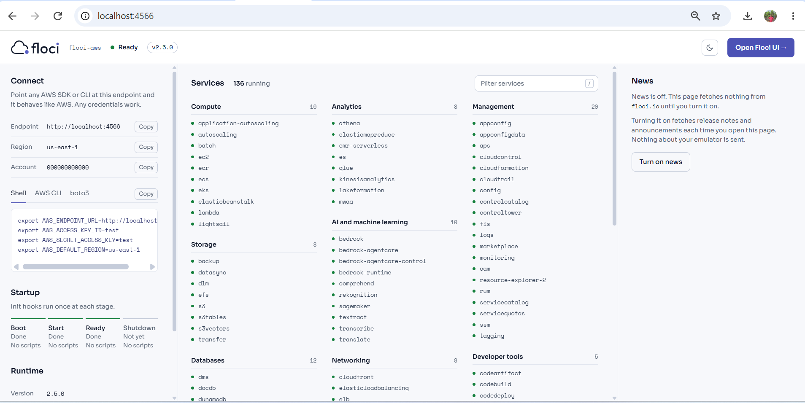
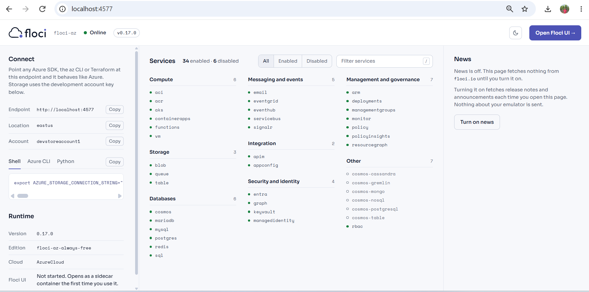

# Floci Multi-Cloud Emulator on WSL — AWS + Azure + GCP + OCI, Locally

**Any cloud. Locally.**

*Light, fluffy, and always free. Local cloud emulators for AWS, Azure, GCP, and OCI.*

Run **four cloud emulators + a web console on your laptop**, with **no cloud account, no credit card, no auth token**.

- Emulators: [Floci](https://floci.io) family — `floci` (AWS), `floci-az` (Azure), `floci-gcp` (GCP), `floci-oci` (OCI)
- Host: WSL2 + Ubuntu + Docker
- Two ways to set it up, same end result
- Includes a cross-cloud **equivalent services matrix**

> **Honest framing:** this is a **local development / learning / CI emulator**. It speaks the real cloud wire protocols, but it is **not** the real cloud. Credentials are dummy, IAM is not truly enforced by default, and service coverage is partial. Never use it to judge production behaviour, security or performance.

---

## Index

1. [What you get](#1-what-you-get)
2. [Architecture](#2-architecture)
3. [Prerequisites](#3-prerequisites)
4. [Repo layout](#4-repo-layout)
5. [Approach 1 — Script install (Floci CLI + docker run)](#5-approach-1--script-install)
6. [Approach 2 — Docker Compose](#6-approach-2--docker-compose)
7. [Approach 1 vs Approach 2](#7-approach-1-vs-approach-2)
8. [Verify it works](#8-verify-it-works)
9. [Cross-cloud service equivalence matrix](#9-cross-cloud-service-equivalence-matrix)
10. [Try a few things](#10-try-a-few-things)
11. [Cheat sheet](#11-cheat-sheet)
12. [Troubleshooting](#12-troubleshooting)
13. [Security notes](#13-security-notes)
14. [Learnings and limitations](#14-learnings-and-limitations)
15. [References](#15-references)

---

## 1. What you get

| Cloud | Emulator image | API endpoint | Console URL |
|---|---|---|---|
| AWS | `floci/floci` | `http://localhost:4566` | `http://localhost:4500/console/aws` |
| Azure | `floci/floci-az` | `http://localhost:4577` | `http://localhost:4500/console/azure` |
| GCP | `floci/floci-gcp` | `http://localhost:4588` | `http://localhost:4500/console/gcp` |
| OCI | `floci/floci-oci` | `http://localhost:4599` | `http://localhost:4500/console/oci` |

- One port per cloud, one container per cloud
- One shared web console (`floci/floci-ui`) on port **4500**
- ⚠️ **Do not open** `http://localhost:4566/_floci/ui` — Floci then starts its **own AWS-only console** on port 4500 (it sets `FLOCI_CLOUD=aws`), and every Azure / GCP / OCI page redirects to AWS. This repo runs the standalone console instead (no `FLOCI_CLOUD` set = serves every cloud)

---

## 2. Architecture



- Emulators mount `docker.sock` so they can start **real containers** for heavier services (e.g. Functions, Kubernetes, databases)
- The UI uses `--network host` so it can reach every emulator on `localhost`

---

## 3. Prerequisites

- Windows 10/11 with **WSL2** and an Ubuntu distro
- `sudo` access in WSL
- Internet access to pull images (first run only)
- ~ a few GB free disk for images
- Optional for deeper tests: AWS CLI, OCI CLI

### Optional — install AWS CLI v2 (for the S3 / DynamoDB tests)

The smoke test prints `AWS CLI not found` if it is missing. Official installer:

```bash
sudo apt-get install -y unzip curl
```

```bash
curl -fsSL "https://awscli.amazonaws.com/awscli-exe-linux-x86_64.zip" -o /tmp/awscliv2.zip
```

```bash
unzip -q /tmp/awscliv2.zip -d /tmp && sudo /tmp/aws/install
```

```bash
aws --version
```

- **Approach 1** already writes dummy credentials and `endpoint_url` to `~/.aws/`
- **Approach 2** does not — set them for the current shell instead:

```bash
export AWS_ACCESS_KEY_ID=test AWS_SECRET_ACCESS_KEY=test AWS_DEFAULT_REGION=us-east-1 AWS_ENDPOINT_URL=http://localhost:4566
```

Check WSL version from PowerShell:

```powershell
wsl -l -v
```

---

## 4. Repo layout

```text
floci-multicloud-poc/
├── README.md
├── LICENSE
├── docs/                      # screenshots (file names are case-sensitive)
├── approach-1-script/
│   ├── install.sh
│   └── cleanup.sh
├── approach-2-compose/
│   ├── install-docker.sh
│   ├── docker-compose.yml
│   └── cleanup.sh
└── scripts/
    ├── endpoints.sh
    └── smoke-test.sh
```

- All commands below run **from the repo root** unless stated
- Pick **one** approach at a time — both use the same ports

---

## 5. Approach 1 — Script install

**Idea:** Floci CLI starts AWS; plain `docker run` starts Azure, GCP, OCI and the UI.

### Step 1 — Run the installer

```bash
bash approach-1-script/install.sh
```

What it does:

- Installs `docker.io` + `docker-compose-v2`, enables Docker, adds you to the `docker` group
- Installs the Floci CLI (`curl -fsSL https://floci.io/install.sh | sh`)
- Writes dummy AWS credentials (`test` / `test`) and region `us-east-1` to `~/.aws/`
- Starts AWS via `floci start --pull always`
- Starts Azure, GCP, OCI with `docker run`
- Replaces the UI container with a host-network one carrying dummy credentials

Expected tail of output:

```text
Done. Console: http://localhost:4500/console/aws
```

### Step 2 — Check containers

```bash
sg docker -c 'docker ps --format "table {{.Names}}\t{{.Ports}}"'
```

Expected: `floci`, `floci-az`, `floci-gcp`, `floci-oci`, `floci-aws-ui`.

### Step 3 — Smoke test

```bash
bash scripts/smoke-test.sh
```

### Step 4 — Show endpoints and console URLs again (any time)

```bash
bash scripts/endpoints.sh
```

### Step 5 — Clean-up (Approach 1)

Scoped clean-up — removes only Floci containers, images, the Floci CLI and the local endpoint override:

```bash
bash approach-1-script/cleanup.sh
```

Full wipe (**destructive**) — removes **every** Docker container, image and volume on the machine and **uninstalls Docker**. Use only on a throwaway WSL distro:

```bash
bash approach-1-script/cleanup.sh full
```

Confirm nothing is left (expected: empty list):

```bash
docker ps -a --filter name=floci
```

---

## 6. Approach 2 — Docker Compose

**Idea:** one `docker-compose.yml` describes the whole stack.

### Step 1 — Install Docker

```bash
bash approach-2-compose/install-docker.sh
```

### Step 2 — Pick up the docker group

```bash
newgrp docker
```

### Step 3 — Move into the compose folder

```bash
cd approach-2-compose
```

### Step 4 — Remove leftovers from Approach 1 (safe if none)

```bash
docker rm -f floci floci-az floci-gcp floci-oci floci-aws-ui 2>/dev/null || true
```

### Step 5 — Start the stack

```bash
docker compose up -d
```

### Step 6 — Check status

```bash
docker compose ps
```

### Step 7 — Go back to the repo root

```bash
cd ..
```

### Step 8 — Show endpoints and console URLs

```bash
bash scripts/endpoints.sh
```

### Step 9 — Smoke test

```bash
bash scripts/smoke-test.sh
```

### Step 10 — Clean-up (Approach 2)

Removes this stack only (containers, network, volumes, Floci images). Docker itself stays installed:

```bash
cd approach-2-compose && bash cleanup.sh && cd ..
```

Confirm nothing is left (expected: empty list):

```bash
docker ps -a --filter name=floci
```

---

## 7. Approach 1 vs Approach 2

| Aspect | Approach 1 — Script | Approach 2 — Compose |
|---|---|---|
| Start AWS | `floci start` (CLI) | compose service `floci-aws` |
| Start Azure/GCP/OCI | 3 × `docker run` | compose services |
| Install Floci CLI | Yes | No |
| Dummy AWS creds in `~/.aws` | Yes (written by script) | No (UI container carries its own) |
| Restart on reboot | Manual | `restart: unless-stopped` |
| Single source of truth | No (commands in a script) | Yes (one YAML) |
| Start / stop whole stack | Several commands | `docker compose up -d` / `down` |
| Clean-up | `approach-1-script/cleanup.sh` | `approach-2-compose/cleanup.sh` |
| Best for | Learning each piece | Repeatable demos, sharing, CI |

- **Recommendation:** use Compose for anything you want to share or repeat; use the script to understand what each piece does

---

## 8. Verify it works

### Port check

```bash
bash scripts/smoke-test.sh
```

Confirmed output from a real run (Approach 2, Ubuntu on WSL2) — `200` on AWS, Azure and UI; `404` on GCP and OCI root URLs:

```text
AWS    port 4566  -> HTTP 200
Azure  port 4577  -> HTTP 200
GCP    port 4588  -> HTTP 404
OCI    port 4599  -> HTTP 404
UI     port 4500  -> HTTP 200
```

- A `404` on the **root URL** is normal for GCP and OCI — they have no page at `/`; it only proves the port is listening
- What the root URL looks like in a browser (confirmed):

| Cloud | `http://localhost:<port>/` shows |
|---|---|
| AWS (4566) | A response (working) |
| Azure (4577) | A response (working) |
| GCP (4588) | `Resource not found` |
| OCI (4599) | `{"code":"NotFound","message":"The requested resource was not found."}` |

- Use the **console URLs** (`http://localhost:4500/console/...`) for a human-friendly view; use the API endpoints from SDKs and CLIs
- The script's second part calls each emulator's **health endpoint**, which is the real check:

| Cloud | Health URL |
|---|---|
| AWS | `http://localhost:4566/_floci/health` |
| Azure | `http://localhost:4577/_floci/health` |
| GCP | `http://localhost:4588/_floci-gcp/health` |
| OCI | `http://localhost:4599/_floci-oci/health` |

- Confirmed from a real run: all four health endpoints return **HTTP 200**



### Browser

- Open `http://localhost:4500/console/aws`
- Switch to `/console/azure`, `/console/gcp`, `/console/oci`
- From Windows, `localhost` is normally forwarded into WSL2 automatically

> **Status:** tested — console pages and health endpoints for all four clouds confirmed working.

| Item | Result |
|---|---|
| WSL distro / version | _e.g. Ubuntu 26.04_ |
| Approach 1 tested | _yes / no_ |
| Approach 2 tested | Yes — all 5 ports answer (see output above); console pages for AWS, Azure, GCP and OCI all load; all 4 health endpoints return HTTP 200 |
| Date tested | _YYYY-MM-DD_ |

---

## 9. Cross-cloud service equivalence matrix

How to read it:

- Names are the **real-cloud equivalents** across AWS / Azure / GCP / OCI
- ✅ = listed as emulated in the upstream Floci docs I checked
- No mark = **not confirmed** as emulated — check the upstream services pages before relying on it
- `—` = no direct single-service equivalent
- Equivalents are *closest match*, not identical features

### Storage

| Category | AWS | Azure | GCP | OCI |
|---|---|---|---|---|
| Object storage | S3 ✅ | Blob Storage ✅ | Cloud Storage ✅ | Object Storage ✅ |
| Queue storage | SQS | Queue Storage ✅ | — | Queue ✅ |
| Table / key-value | DynamoDB ✅ | Table Storage ✅ | Datastore ✅ | NoSQL Database |
| Block disks | EBS | Managed Disks | Persistent Disk | Block Volume |
| File shares | EFS | Azure Files | Filestore | File Storage |

### Databases

| Category | AWS | Azure | GCP | OCI |
|---|---|---|---|---|
| NoSQL document | DynamoDB ✅ | Cosmos DB ✅ | Firestore ✅ | NoSQL Database |
| Managed relational | RDS | Azure SQL Database ✅ | Cloud SQL ✅ | MySQL HeatWave / Base Database |
| In-memory cache | ElastiCache | Azure Cache for Redis ✅ | Memorystore | OCI Cache |
| Data warehouse | Redshift | Synapse Analytics | BigQuery | Autonomous Data Warehouse |
| Global relational | Aurora DSQL | — | Spanner | — |

### Messaging and events

| Category | AWS | Azure | GCP | OCI |
|---|---|---|---|---|
| Pub/sub topics | SNS | Service Bus topics ✅ | Pub/Sub ✅ | Notifications |
| Message queue | SQS | Service Bus queues ✅ | Pub/Sub (pull) ✅ | Queue ✅ |
| Streaming / Kafka-style | Kinesis / MSK | Event Hubs ✅ | Pub/Sub / Managed Kafka | Streaming ✅ |
| Event routing | EventBridge | Event Grid | Eventarc ✅ | Events |
| Scheduler | EventBridge Scheduler | Logic Apps / Functions timer | Cloud Scheduler ✅ | Events + Functions |

### Compute and containers

| Category | AWS | Azure | GCP | OCI |
|---|---|---|---|---|
| Virtual machines | EC2 ✅ | Virtual Machines ✅ | Compute Engine | Compute Instances |
| Serverless functions | Lambda | Azure Functions ✅ | Cloud Run functions | Functions ✅ |
| Serverless containers | ECS / Fargate ✅ | Container Apps / ACI | Cloud Run ✅ | Container Instances |
| Managed Kubernetes | EKS ✅ | AKS ✅ | GKE ✅ | OKE ✅ |
| Container registry | ECR | Container Registry ✅ | Artifact Registry | Container Registry (OCIR) |
| CI build | CodeBuild ✅ | Azure Pipelines | Cloud Build | DevOps Build |

### Security and identity

| Category | AWS | Azure | GCP | OCI |
|---|---|---|---|---|
| Identity / access | IAM | Entra ID ✅ | Cloud IAM | IAM (Identity) ✅ |
| Secrets | Secrets Manager | Key Vault ✅ | Secret Manager ✅ | Vault (Secrets) |
| Encryption keys | KMS | Key Vault (keys) ✅ | Cloud KMS | KMS ✅ |

### Management and delivery

| Category | AWS | Azure | GCP | OCI |
|---|---|---|---|---|
| API gateway | API Gateway | API Management ✅ | API Gateway | API Gateway |
| App configuration | AppConfig ✅ | App Configuration ✅ | Parameter Manager | — |
| Infrastructure as code | CloudFormation ✅ | ARM / Bicep | Infrastructure Manager | Resource Manager |
| Monitoring | CloudWatch | Azure Monitor | Cloud Monitoring | Monitoring |
| Billing | Billing / Budgets | Cost Management | Cloud Billing ✅ | Cost Analysis |
| Backup | Backup ✅ | Azure Backup | Backup and DR | — |

- AWS emulation is broad (upstream cites **51 services**); the ✅ marks above are only the ones I could confirm — many more AWS services exist in Floci
- Azure, GCP and OCI emulators are newer and **narrower** than AWS
- OCI has no official local emulator from Oracle — `floci-oci` fills that gap

---

### Screenshots

**Web console** (`http://localhost:4500/console/...`)

| AWS | Azure |
|---|---|
|  |  |

| GCP | OCI |
|---|---|
|  |  |

**API endpoints in the browser** (`http://localhost:4566/` and `http://localhost:4577/`)

| AWS | Azure |
|---|---|
|  |  |

---

## 10. Try a few things

### AWS — S3 bucket

```bash
aws s3 mb s3://my-bucket
```

```bash
aws s3 ls
```

Expected: `my-bucket` listed. (The `endpoint_url` in `~/.aws/config` from Approach 1 sends this to `localhost:4566`.)

### AWS — DynamoDB table

```bash
aws dynamodb create-table --table-name demo --attribute-definitions AttributeName=pk,AttributeType=S --key-schema AttributeName=pk,KeyType=HASH --billing-mode PAY_PER_REQUEST
```

```bash
aws dynamodb list-tables
```

### OCI — namespace (needs OCI CLI)

```bash
oci os ns get --endpoint http://localhost:4599
```

### GCP — point SDKs at the emulator

```bash
export PUBSUB_EMULATOR_HOST=localhost:4588 FIRESTORE_EMULATOR_HOST=localhost:4588 STORAGE_EMULATOR_HOST=http://localhost:4588 GOOGLE_CLOUD_PROJECT=floci-local
```

### Azure — Blob SDK

- Point the Azure Storage SDK / Azurite-style connection at `http://localhost:4577`
- Exact paths follow the account name, e.g. `/{account}/` for Blob — see the floci-az docs

---

## 11. Cheat sheet

| Task | Command |
|---|---|
| List Floci containers | `docker ps --filter name=floci` |
| Logs of one emulator | `docker logs -f floci-az` |
| Restart one emulator | `docker restart floci-gcp` |
| Stop AWS (Approach 1) | `floci stop` |
| Stack up (Approach 2) | `docker compose up -d` |
| Stack down (Approach 2) | `docker compose down` |
| Update images (Approach 2) | `docker compose pull && docker compose up -d` |
| Who is using a port | `sudo ss -ltnp \| grep 4566` |
| Disk used by Docker | `docker system df` |
| Env vars for AWS CLI | `eval $(floci env)` |

| Port | Purpose |
|---|---|
| 4566 | AWS API |
| 4577 | Azure API |
| 4588 | GCP API |
| 4599 | OCI API |
| 4500 | Web console |

---

## 12. Troubleshooting

| Symptom | Likely cause | Fix |
|---|---|---|
| `permission denied` on `/var/run/docker.sock` | Group change not active yet | `newgrp docker` or reopen the terminal |
| `port is already allocated` | Other approach still running | Run the clean-up for the other approach first |
| `docker: command not found` | Install step failed | Re-run the install script and read the first error |
| `Cannot connect to the Docker daemon` | Docker service not running (no systemd in WSL) | `sudo service docker start`; check `systemctl` support in `/etc/wsl.conf` |
| Azure / GCP / OCI console pages redirect to the AWS screen | The AWS-only console started by Floci (`FLOCI_CLOUD=aws`) is the one on port 4500, often because `/_floci/ui` was opened or the standalone UI failed to start | `docker rm -f floci-aws-ui floci-ui`, then start the standalone UI (`docker run ... floci/floci-ui`, see install.sh) or `docker compose up -d floci-ui`; do not open `/_floci/ui` |
| `container name "/floci-aws-ui" is already in use` | Floci recreated its UI sidecar after the script removed it (timing) | `docker rm -f floci-aws-ui` and start the UI again; the fixed install.sh retries automatically |
| Console shows "Not connected" for a cloud | Emulator not healthy | `curl localhost:4566/_floci/health`, `curl localhost:4577/_floci/health`, `curl localhost:4588/_floci-gcp/health`, `curl localhost:4599/_floci-oci/health` |
| Console on 4500 not loading | UI container not up / host networking | `docker logs floci-aws-ui`; confirm port 4500 is free |
| AWS CLI hits real AWS | No `endpoint_url` set | Use `--endpoint-url http://localhost:4566` or `eval $(floci env)` |
| AWS CLI hits localhost after clean-up | `endpoint_url` left in `~/.aws/config` | Remove the line (clean-up script does this) |
| `floci: command not found` | CLI install failed or not on PATH | Re-run installer; check `/usr/local/bin/floci` |
| Functions / Kubernetes features fail | Docker socket not mounted | Keep `-v /var/run/docker.sock:/var/run/docker.sock` on that emulator |
| Image pull is slow / fails | Network or registry limits | Retry; check `docker pull floci/floci:latest` alone |
| Works in WSL but not from Windows browser | `localhost` forwarding off | Use the WSL IP (`hostname -I`) |

---

## 13. Security notes

- Emulators mount `/var/run/docker.sock` → **they can control Docker on your machine (root-equivalent)**. Run on a personal dev box only
- Dummy credentials (`test` / `test`) — never reuse real keys here
- Do not expose ports 4500 / 4566 / 4577 / 4588 / 4599 to a network
- `curl -fsSL https://floci.io/install.sh | sh` runs a remote script — read it first if you care
- Pin image tags (e.g. `floci/floci:<version>`) instead of `latest` for repeatable demos

---

## 14. Learnings and limitations

- One port per cloud keeps endpoints simple to remember
- Compose gives a repeatable, shareable setup; scripts teach the moving parts
- Heavier services spin up **real containers**, so first use can be slow and needs the Docker socket
- Coverage differs a lot between clouds — AWS is the most mature, OCI is the newest
- Emulators accept **any** credentials by default — IAM behaviour is not production-faithful
- Behaviour, versions and service lists change quickly — treat the matrix as a starting point and check upstream

**Ideas for next steps**

- Terraform / OpenTofu against each endpoint
- Run the same app against S3 → Blob → GCS → OCI Object Storage to compare SDKs
- Use it in CI instead of real cloud accounts
- Persist state with the emulators' storage-mode settings

---

## 15. References

- Floci (AWS): https://github.com/floci-io/floci
- Floci docs: https://floci.io
- floci-az (Azure): https://github.com/floci-io/floci-az
- floci-gcp (GCP): https://github.com/floci-io/floci-gcp — services: https://floci.io/floci-gcp/services/
- floci-oci (OCI): https://github.com/floci-io/floci-oci
- Floci CLI: https://github.com/floci-io/floci-cli
